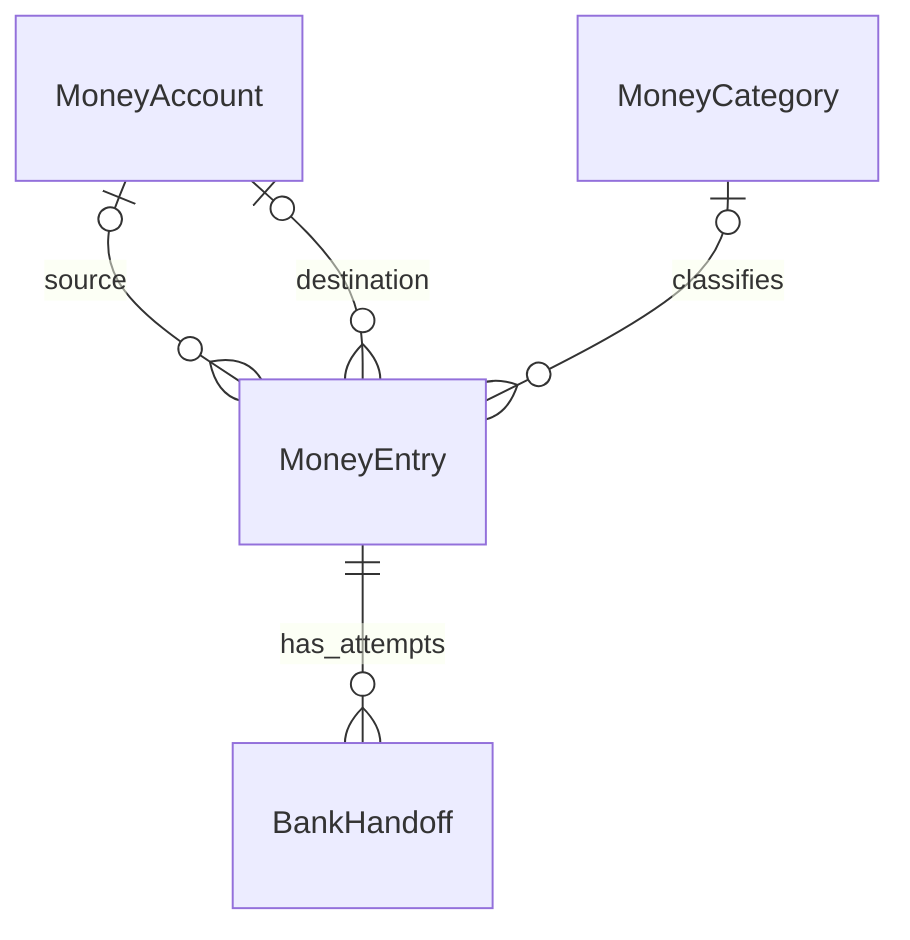

# MoneyFlow — Thiết kế dữ liệu và nghiệp vụ

Tên sản phẩm tạm dùng: **MoneyFlow**. Tài liệu này thay thế hướng TaskFlow quản lý công việc trước đây. Trạng thái: đặc tả để triển khai, chưa có database hoặc tích hợp MB trong source app.

## 1. Phạm vi đã chốt

App SwiftUI quản lý thu, chi và dòng tiền cá nhân theo từng tài khoản. Bản đầu lưu offline bằng SwiftData, dùng VND, không đăng nhập và không tự đồng bộ ngân hàng.

Luồng trọng tâm:

```text
Nhập 20k — Mua rau → chọn tài khoản MB → lưu nháp
→ Mở MB để thanh toán → người dùng thanh toán trong MB
→ quay lại MoneyFlow → kiểm tra thông tin → Đã thanh toán — Ghi khoản chi
→ cập nhật chính bản nháp → dòng tiền MB và báo cáo được cập nhật
```

App không kiểm tra kết quả thanh toán ngân hàng. Người dùng tự xác nhận, tự đối soát ngân hàng sau. Mở được MB hoặc quay lại app không chứng minh tiền đã chuyển.

MVP có:
- Tài khoản ghi chép: Tiền mặt, MB cá nhân, ngân hàng khác, MoMo…
- Nhập thu/chi thủ công, danh mục, ghi chú và thời gian giao dịch.
- Chuyển tiền nội bộ giữa hai tài khoản đang theo dõi.
- Bản nháp khoản chi trước khi mở MB; xác nhận một lần để ghi sổ.
- Giao dịch theo tài khoản/ngày, báo cáo thu chi theo kỳ và danh mục.
- Đối soát thủ công và điều chỉnh số dư có ghi nhận riêng.
- Sửa giao dịch, xóa mềm, khôi phục và lưu trữ tài khoản/danh mục.

Ngoài phạm vi: tự xác minh giao dịch, đọc số dư/sao kê/SMS/thông báo ngân hàng, lưu thông tin đăng nhập/OTP, tự chuyển tiền, liên kết tài khoản thật, cloud sync, nhiều loại tiền, chia sẻ ví và ngân sách tự động. Không thiết kế lịch/báo thức hoặc task to-do theo bộ docs cũ.

## 2. Trải nghiệm và thuật ngữ

- **Tài khoản** là nơi người dùng ghi dòng tiền, không phải kết nối ngân hàng. Dùng “Thanh toán bằng MB”, không dùng “Đã liên kết MB”.
- **Số dư theo ghi chép** được tính từ số dư ban đầu và các giao dịch đã ghi; có thể khác số dư thật.
- **Bản nháp** chưa tác động số dư hoặc báo cáo.
- **Đã ghi nhận** nghĩa là người dùng xác nhận ghi sổ; không gọi là “Ngân hàng đã xác minh”.
- Hỗ trợ nhập `20k` thành `20.000đ`, nhưng trước khi lưu phải hiện số tiền đầy đủ để kiểm tra.
- Nhập nhanh chỉ cần số tiền, danh mục và tài khoản; nội dung/ngày giờ có thể mặc định rồi chỉnh sửa. Không có tài khoản thì tạo tài khoản đầu tiên trước khi ghi sổ.
- Mở ngân hàng và ghi nhận là hai thao tác riêng. Khi không mở được MB vẫn giữ bản nháp, có đường thanh toán thủ công.

## 3. Kiến trúc

```text
SwiftUI View → ViewModel → FinanceService → Repository → SwiftData
                                ↓
                        BankAppLauncher (mở app)
```

FinanceService validation, ghi nhận, chuyển tiền, xóa/khôi phục và tính số dư. Repository lưu các thay đổi nhất quán. BankAppLauncher chỉ báo kết quả mở đường dẫn; không trả trạng thái thanh toán thành công.

ModelContainer cấu hình kho SwiftData; ModelContext đọc/ghi model. Khai báo schema V1 và migration trước phát hành. Thiết lập theme/tài khoản mặc định dùng UserDefaults hoặc AppStorage. Không thêm backend chỉ để ghi chép và mở app ngân hàng.

## 4. Quan hệ dữ liệu



Một giao dịch là **một MoneyEntry**, kể cả chuyển nội bộ. Không tạo hai khoản thu/chi độc lập cho cùng một lần chuyển nội bộ. Số dư được tính từ nguồn dữ liệu này, không lưu thêm bảng tổng hợp có thể lệch.

Các quan hệ là SwiftData model reference, không lưu thêm UUID foreign key trùng nghĩa. UUID ổn định dùng để điều hướng, nhận diện bản nháp và chống ghi trùng.

### MoneyAccount — Tài khoản ghi chép

| Trường | Kiểu | Quy tắc |
|---|---|---|
| id | UUID | Duy nhất trong entity, tạo một lần |
| name | String | Trim, 1–60 ký tự, ví dụ MB cá nhân |
| typeRaw | String | `cash`, `bank`, `ewallet` |
| bankCode | String? | Mã ngân hàng được hỗ trợ; không có nghĩa đã kết nối |
| accountSuffix | String? | Tối đa 4 ký tự cuối để phân biệt, không bắt buộc |
| currencyCode | String | `VND` trong MVP |
| openingBalanceVND | Int64 | Có dấu, số dư tại mốc bắt đầu ghi chép |
| openingAt | Date | Mốc bắt đầu tính số dư, mặc định đầu ngày tạo tài khoản |
| colorHex / iconName | String | Giá trị từ bộ lựa chọn được hỗ trợ |
| sortOrder | Int | Thứ tự hiển thị |
| isArchived | Bool | Mặc định false |
| createdAt / updatedAt | Date | Metadata |
| outgoingEntries / incomingEntries | [MoneyEntry] | Inverse riêng cho hai quan hệ nguồn/đích |

Tên tài khoản đang hoạt động không trùng sau trim và so sánh không phân biệt hoa/thường. Số dư có thể âm; không chặn ghi sổ chỉ vì số dư ghi chép không đủ. Hiển thị thông tin để người dùng kiểm tra.

Không hard-delete tài khoản đã được bất kỳ entry nào tham chiếu, kể cả nháp/thùng rác. Cho lưu trữ; chỉ xóa vĩnh viễn tài khoản rỗng. Tài khoản lưu trữ vẫn nằm trong số liệu lịch sử và tổng tài sản, nhưng không cho tạo/ghi nhận giao dịch mới vào đó. Có tùy chọn xem/khôi phục riêng.

### MoneyCategory — Danh mục thu/chi

| Trường | Kiểu | Quy tắc |
|---|---|---|
| id | UUID | Định danh ổn định |
| name | String | Trim, 1–60 ký tự |
| kindRaw | String | `income` hoặc `expense` |
| colorHex / iconName | String | Hỗ trợ phân biệt bằng chữ/icon, không chỉ màu |
| sortOrder | Int | Thứ tự trong nhóm thu hoặc chi |
| isArchived | Bool | Ẩn khỏi picker tạo mới, giữ lịch sử |
| createdAt / updatedAt | Date | Metadata |
| entries | [MoneyEntry] | Inverse category |

MVP dùng danh mục một cấp. Gợi ý chi: Thực phẩm, Ăn ngoài, Di chuyển, Mua sắm, Nhà ở, Sức khỏe, Học tập, Khác. Gợi ý thu: Lương, Thưởng, Thu khác. Có thể thêm/sửa danh mục; không đổi kind của danh mục đã có entry. Không trùng tên trong cùng kind giữa các danh mục hoạt động.

Danh mục đã dùng chỉ lưu trữ. Không cascade xóa entry khi xóa danh mục rỗng. Đổi tên danh mục cập nhật nhãn trong báo cáo lịch sử, không thay đổi số tiền.

### MoneyEntry — Giao dịch hoặc bản nháp

| Trường | Kiểu | Quy tắc |
|---|---|---|
| id | UUID | Định danh xuyên suốt từ nháp đến ghi nhận |
| kindRaw | String | `expense`, `income`, `transfer`, `adjustment` |
| statusRaw | String | `draft` hoặc `recorded` |
| amountVND | Int64 | Số tiền dương nguyên đồng; không dùng Float/Double |
| title | String | Trim, tối đa 200 ký tự; có thể lấy tên danh mục nếu bỏ trống |
| notes | String | Mặc định rỗng, tối đa 10.000 ký tự |
| occurredAt | Date | Thời điểm chi/thu/chuyển/điều chỉnh do người dùng xác nhận |
| recordedAt | Date? | Thời điểm app ghi nhận; chỉ có khi recorded |
| confirmationSourceRaw | String? | `user`; nil khi draft |
| sourceAccount | MoneyAccount? | Tài khoản trừ tiền, theo bảng ràng buộc bên dưới |
| destinationAccount | MoneyAccount? | Tài khoản cộng tiền |
| category | MoneyCategory? | Bắt buộc cho income/expense khi ghi nhận |
| recipientBankCode | String? | Ngân hàng người nhận, khác với ngân hàng nguồn |
| recipientAccountNo | String? | Chuỗi tài khoản người nhận; giữ số 0 đầu |
| recipientName | String? | Tên người nhận nếu có |
| transferContent | String? | Nội dung gửi sang app ngân hàng nếu hỗ trợ |
| deletedAt | Date? | Xóa mềm; vẫn giữ trạng thái trước khi xóa |
| createdAt / updatedAt | Date | Metadata |
| handoffs | [BankHandoff] | Các lần thử mở ngân hàng |

Thông tin người nhận là snapshot của lần chi, không phải tài khoản sở hữu của người dùng. Chỉ bắt buộc khi muốn mở màn chuyển khoản có điền sẵn; mở MB chung vẫn có thể thực hiện rồi nhập người nhận trong MB. Không tự suy ra MB là ngân hàng nhận.

Ràng buộc khi recorded:

| kind | sourceAccount | destinationAccount | category |
|---|---|---|---|
| expense | Bắt buộc | nil | Loại expense |
| income | nil | Bắt buộc | Loại income |
| transfer | Bắt buộc | Bắt buộc, khác nguồn | nil |
| adjustment giảm | Bắt buộc | nil | nil |
| adjustment tăng | nil | Bắt buộc | nil |

Adjustment bắt buộc có ghi chú lý do; không có hai đầu tài khoản cùng lúc. Amount luôn dương, chiều cộng/trừ lấy từ quan hệ tài khoản. Giới hạn thiết kế amount ≤ 1.000.000.000.000 VND; kiểm tra tràn Int64 khi cộng tổng. Đây là giới hạn nhập của app, không phải hạn mức thanh toán ngân hàng.

Bản nháp cho phép thiếu danh mục hoặc tài khoản trong quá trình soạn; lưu nháp bền vững cần amount hợp lệ. Chỉ validate đủ tất cả trường trước khi recorded. Không cho occurredAt ở tương lai hoặc trước openingAt của tài khoản liên quan khi ghi sổ. Muốn ghi lịch sử sớm hơn phải chủ động sửa mốc và số dư ban đầu tương ứng.

### BankHandoff — Lần mở app ngân hàng

| Trường | Kiểu | Quy tắc |
|---|---|---|
| id | UUID | Một ID mỗi lần người dùng bấm mở ngân hàng |
| entry | MoneyEntry | Cha bắt buộc |
| providerRaw | String | `mb` trong tích hợp đầu tiên |
| modeRaw | String | `launchOnly` hoặc `prefilledTransfer` |
| amountSnapshotVND | Int64 | Số tiền tại thời điểm mở; không thay cho số tiền cuối cùng |
| launchStateRaw | String | `requested`, `opened`, `failed` |
| requestedAt | Date | Bắt đầu thao tác |
| openedAt | Date? | Lời gọi mở URL báo được hệ thống tiếp nhận |
| errorCode | String? | Mã lỗi phục vụ UI/retry, không lưu dữ liệu bí mật |

`opened` không đảm bảo màn chuyển tiền đã điền đúng và không xác nhận giao dịch. Không có trạng thái `paymentSucceeded` ở entity này. Không persist full URL chứa thông tin người nhận vào log; tạo URL khi cần từ bản nháp và encode bằng URLComponents.

## 5. Nghiệp vụ mở MB và ghi khoản chi

1. Người dùng nhập số tiền, danh mục, nguồn tiền và tùy chọn người nhận/ghi chú.
2. Bấm **Mở MB để thanh toán**: lưu entry trạng thái draft trước. Nếu lưu lỗi, giữ form và chưa mở MB.
3. Tạo BankHandoff; adapter chọn launchOnly hoặc prefilledTransfer theo khả năng đã xác minh. Không gắn nhãn tự điền nếu chỉ mở app.
4. Mở URL từ hành động trực tiếp của người dùng. MB thực hiện đăng nhập, kiểm tra người nhận và xác thực chuyển tiền; MoneyFlow không thực hiện các bước đó.
5. Nếu mở lỗi: báo không mở được, giữ draft; cho thử lại hoặc tự mở MB. Nếu app bị đóng trong lúc chuyển app, draft vẫn được giữ.
6. Khi foreground: nếu có draft vừa mở ngân hàng, đưa lối vào xác nhận. Không tự ghi nhận, không tự mở lại MB, không hỏi liên tục sau khi người dùng chọn Để sau. Nhiều draft thì cho chọn đúng giao dịch, không tự áp kết quả cho tất cả.
7. Sheet xác nhận hiển thị số tiền, nguồn tiền, ngày giờ, nội dung và danh mục. Cho sửa số tiền/tài khoản nếu thực tế thanh toán khác. Người dùng chọn lại occurredAt; gợi ý thời điểm xác nhận hiện tại và hiển thị rõ trước khi lưu, không giả định đó là thời gian ngân hàng xác thực.
8. **Đã thanh toán — Ghi khoản chi**: validate, đổi chính entry từ draft sang recorded, gán recordedAt/confirmationSource và save. Chỉ báo thành công sau save.
9. **Chưa thanh toán** hoặc **Để sau**: giữ draft, không ảnh hưởng dòng tiền. Có thao tác xóa draft riêng.

Chống ghi trùng: thao tác confirm theo entry ID, chạy tuần tự trong service, khóa nút khi lưu. Nếu entry đã recorded, trả kết quả hiện tại, không tạo entry mới hoặc cập nhật occurredAt lần nữa. Sau save lỗi, rollback để retry không làm lệch trạng thái.

Không bắt buộc phải mở ngân hàng trước khi ghi khoản chi. Người dùng đã thanh toán tiền mặt hoặc chuyển khoản ngoài app có thể chọn **Đã thanh toán — Ghi khoản chi** trực tiếp.

## 6. Dòng tiền và số dư

Chỉ entry có `statusRaw == recorded && deletedAt == nil` tham gia tính toán.

```text
Số dư theo ghi chép của tài khoản
  = openingBalanceVND
  + tổng amount của entries có destinationAccount là tài khoản đó
  − tổng amount của entries có sourceAccount là tài khoản đó
```

Số dư tại thời điểm T chỉ gồm entry có occurredAt ≤ T; tài khoản chưa tới openingAt tại T hiển thị Chưa bắt đầu ghi chép. Không lưu thêm currentBalanceVND trong Account để tránh lệch khi sửa/xóa giao dịch.

- Chi theo kỳ: tổng expense trong kỳ; thu theo kỳ: tổng income trong kỳ.
- Chuyển nội bộ tác động từng tài khoản nhưng không tính vào thu/chi tiêu toàn app. Trong màn tài khoản, hiển thị nhóm Chuyển vào/Chuyển ra riêng.
- Điều chỉnh số dư tác động tài khoản nhưng không tính thành thu nhập hoặc chi tiêu. Trong báo cáo dòng tiền có dòng Điều chỉnh riêng để giải thích chênh lệch.
- Tổng số dư toàn app gồm tất cả tài khoản, cả tài khoản lưu trữ; lưu trữ không được làm tổng tiền tự biến mất. Có thể lọc tài khoản, nhưng ghi rõ phạm vi tổng.
- Ngày/kỳ báo cáo dùng occurredAt, không dùng recordedAt hoặc thời điểm mở MB.
- Không coi số dư giảm hay khoản ghi tay là bằng chứng thanh toán thật.

Ví dụ: MB ban đầu 1.000.000đ; nháp Mua rau 20.000đ giữ số dư 1.000.000đ. Ghi nhận khoản chi thì còn 980.000đ. Chuyển 100.000đ từ MB sang Tiền mặt làm MB còn 880.000đ và Tiền mặt tăng 100.000đ; tổng chi vẫn là 20.000đ.

## 7. Đối soát thủ công

Trong chi tiết tài khoản, người dùng xem số dư theo ghi chép và tự mở ngân hàng để so sánh. MoneyFlow không truy vấn ngân hàng.

Khi chọn **Đối soát số dư**:
1. Hiện số dư theo ghi chép hiện tại.
2. Người dùng nhập số dư thực tế vừa kiểm tra; hiện chênh lệch và gợi ý kiểm tra khoản thiếu/trùng trước.
3. Cho Hủy hoặc **Ghi điều chỉnh** kèm lý do bắt buộc. Chênh lệch bằng 0 thì báo đã khớp, không tạo entry 0 đồng.
4. Service tính lại số dư trong cùng ngữ cảnh ghi trước commit, tránh dùng chênh lệch cũ nếu dữ liệu vừa thay đổi.
5. Tạo một adjustment recorded theo chiều tăng/giảm, occurredAt là thời điểm đối soát; không sửa đè toàn bộ lịch sử hoặc openingBalance.

Đây là số dư do người dùng nhập, không có trạng thái “Ngân hàng xác minh”. Chỉ sửa openingBalance/openingAt trong mục thiết lập ban đầu với cảnh báo tác động số dư lịch sử; giữ các entry đã recorded vẫn hợp lệ sau thay đổi.

## 8. Sửa, xóa và lưu trữ

- Sửa entry recorded: giữ ID/recordedAt, cập nhật updatedAt, validate rồi lưu; số dư và báo cáo tự tính lại. ConfirmationSource vẫn là user.
- Chuyển nội bộ sửa một entry duy nhất để hai tài khoản cập nhật cùng lúc. Phí chuyển khoản nếu có là expense riêng; không trừ ngầm phí trong transfer.
- Xóa mềm entry: gán deletedAt, lập tức loại ảnh hưởng khỏi số dư/báo cáo. UI nêu rõ hệ quả và có Hoàn tác. Xóa ghi chép không hoàn tiền ngân hàng.
- Khôi phục: xóa deletedAt, đưa lại ảnh hưởng vào số dư nếu entry recorded. Entry draft khôi phục vẫn là draft. Khi tài khoản/danh mục lưu trữ, cho khôi phục nguyên trạng lịch sử nhưng muốn sửa phải khôi phục các đối tượng liên quan hoặc chọn đối tượng hoạt động khác.
- Xóa vĩnh viễn: chỉ từ thùng rác, cần xác nhận; cascade BankHandoff. Không thay đổi số dư thêm lần nữa vì ảnh hưởng đã loại ở bước xóa mềm.
- Không tự dọn thùng rác trong MVP; tránh xóa lịch sử tài chính ngoài ý muốn. Thùng rác không tính vào báo cáo.
- Mỗi thao tác ghi/sửa phải save thành công trước thông báo UI; không reset database khi lỗi migration/store.

## 9. Truy vấn, dữ liệu đầu vào và thời gian

| Màn | Nguồn dữ liệu |
|---|---|
| Tổng quan | Entries recorded chưa xóa theo kỳ, số dư theo ghi chép |
| Giao dịch | Recorded chưa xóa, nhóm occurredAt theo ngày, mới nhất trước |
| Tài khoản MB | Entries có MB là source/destination, phân biệt chi/thu/chuyển/điều chỉnh |
| Bản nháp | Draft chưa xóa, mới cập nhật trước; không có ảnh hưởng số dư |
| Báo cáo | Income/expense theo kỳ và danh mục; transfer/adjustment riêng |
| Thùng rác | deletedAt khác nil, giữ loại và trạng thái gốc |

Lọc tài khoản/danh mục/loại/thời gian kết hợp AND. Search theo title/notes; tìm người nhận bổ sung nếu có. Thứ tự phụ theo createdAt rồi UUID để ổn định.

Parser tiền phải có quy tắc rõ: nhận số nguyên đồng và hậu tố k/K cho nghìn, ví dụ `20k`, `20 k`, `20.000`, `20000`. Không tự đoán chuỗi nhập mơ hồ như `20,5`; báo định dạng cần dùng. Có thể bổ sung định dạng khác sau khi chốt parser. Luôn preview số tiền chuẩn bằng formatter VND trước ghi nhận. Không lưu amount dạng chuỗi có dấu phân cách.

Persist Date là thời điểm tuyệt đối; nhóm ngày và khoảng báo cáo theo lịch/múi giờ hiện tại của thiết bị. Đổi múi giờ có thể đổi nhóm ngày; không thay thời điểm gốc. Dùng khoảng [đầu ngày, đầu ngày kế tiếp), không cộng cứng 86.400 giây. MVP không hẹn ghi nhận giao dịch tương lai.

## 10. Tích hợp MB và giới hạn kỹ thuật

- VietQR.io công bố hỗ trợ autofill MBBank từ 31/07/2026. Kiểm thử trên iPhone thật với phiên bản MB hiện tại trước khi bật prefilledTransfer; đây là tích hợp của nhà cung cấp, không phải giao thức mặc định cho mọi ngân hàng.
- Phân biệt app nguồn `mb` với ngân hàng/tài khoản người nhận trong link. URL encode đúng số tiền nguyên đồng, nội dung và thông tin nhận; không hardcode tài khoản mẫu thật trong production.
- Mặc định launchOnly khi chưa xác minh khả năng điền sẵn; nếu adapter không khả dụng, cung cấp cách thanh toán thủ công. UI không hứa mở màn chuyển khoản khi chỉ mở trang chính.
- Kiểm tra scheme/Universal Link theo tài liệu nhà cung cấp; cấu hình LSApplicationQueriesSchemes nếu dùng canOpenURL cho custom scheme. Không thử dò hàng loạt app hoặc dựa vào đường dẫn suy đoán.
- Không cần webhook, callback thanh toán hoặc cổng merchant trong phạm vi đã chốt. Đường quay về nếu hỗ trợ chỉ dùng điều hướng đúng draft.
- Khi dùng dịch vụ link bên thứ ba, thông tin nằm trong link có thể đi qua nhà cung cấp; chỉ gửi các trường cần cho chuyển khoản, không gửi ghi chú chi tiêu riêng. Nêu điều này trong thông tin sử dụng tính năng.
- Không thu thập mật khẩu/OTP/PIN; không tự động thao tác UI ngân hàng. Các quyền ngân hàng không phải điều kiện để dùng sổ thu chi.
- iPad/macOS/visionOS vẫn có ghi chép đầy đủ; chỉ hiện nút mở MB khi adapter hỗ trợ nền tảng và có đường mở hợp lệ.

Nguồn kỹ thuật:
- [VietQR.io — cập nhật autofill MB](https://www.vietqr.io/changelog/)
- [VietQR.io — deeplink ngân hàng và tham số](https://www.vietqr.io/danh-sach-api/deeplink-app-ngan-hang/)
- [Apple — UIApplication.open](https://developer.apple.com/documentation/uikit/uiapplication)
- [Apple — SwiftData](https://developer.apple.com/documentation/swiftdata)

Không gọi URL thanh toán thật trong preview, unit test hoặc bước kiểm tra UI tự động. Kiểm thử tích hợp trên thiết bị dừng trước xác nhận chuyển tiền, trừ khi người dùng chủ động thực hiện giao dịch thật.

## 11. Gợi ý triển khai và nghiệm thu

```text
Models/MoneyAccount.swift, MoneyCategory.swift, MoneyEntry.swift, BankHandoff.swift
Data/Storage/MoneyFlowSchema.swift, PersistenceController.swift
Data/Repositories/FinanceRepository.swift
Services/FinanceService.swift, BankAppLauncher.swift
Shared/Utilities/VNDInputParser.swift, ReportingPeriod.swift
ViewModels/OverviewViewModel.swift, EntryEditorViewModel.swift, AccountDetailViewModel.swift
Views/Screens/Overview/, Transactions/, Accounts/, Reports/, Settings/
```

Thứ tự triển khai: model/persistence → tài khoản và danh mục → ghi thu/chi → nháp/xác nhận → mở MB → chuyển nội bộ → báo cáo → đối soát/xóa/khôi phục.

| Tình huống | Kết quả mong đợi |
|---|---|
| Nhập 20k | Preview/lưu 20.000đ, không lưu 20đ |
| Lưu nháp rồi mở MB | Nháp tồn tại bền vững, số dư chưa đổi |
| MB không mở được | Nháp còn nguyên, có retry/thanh toán thủ công |
| Quay lại hoặc khởi động lại app | Có thể tìm và xác nhận đúng nháp, không tự ghi sổ |
| Bấm xác nhận nhiều lần | Một entry recorded, trừ tiền đúng một lần |
| Sửa số tiền/tài khoản ở sheet xác nhận | Ghi theo thông tin cuối, không theo handoff snapshot |
| Save lỗi khi confirm | Không báo thành công, không trừ tiền, cho thử lại |
| Ghi thu 500k vào MB | MB tăng 500k, báo cáo thu tăng tương ứng |
| Chuyển MB → Tiền mặt 100k | Một entry, hai số dư đổi, tổng thu/chi không tăng |
| Ghi adjustment giảm 10k | Số dư giảm, báo cáo chi không tăng |
| Xóa/khôi phục expense | Số dư tăng/giảm tương ứng, không hoàn tiền thật |
| Lưu trữ tài khoản có lịch sử | Lịch sử và tổng số dư không mất |
| Xóa vĩnh viễn entry trong thùng rác | Không đổi số dư lần thứ hai, không còn handoff mồ côi |
| Lọc ngày | Dùng occurredAt và múi giờ báo cáo, không dùng recordedAt |
| Đối soát khớp số dư | Không tạo adjustment 0đ |
| Store/migration lỗi | Giữ dữ liệu, không tự reset |
